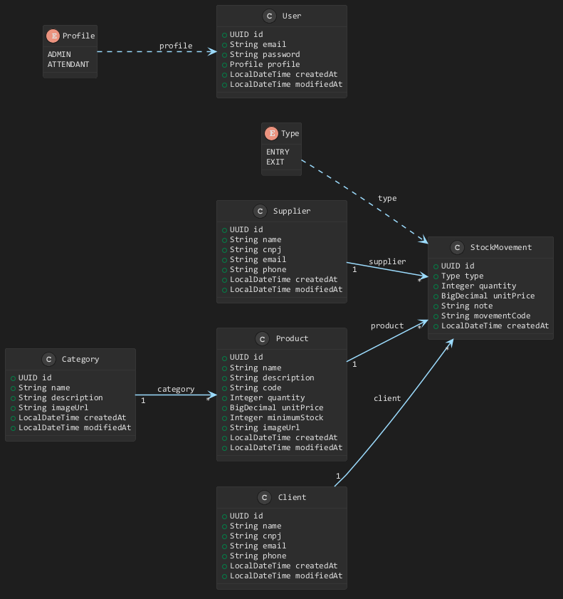

# Controle de Estoque

Este projeto é uma API para cuidar do dia a dia de um estoque: cadastrar produtos, organizar categorias, manter clientes e fornecedores e registrar entradas e saídas. Também dá para gerar um relatório em PDF com as movimentações.

Fiz o projeto para praticar Java e Spring Boot em uma aplicação mais completa, incluindo autenticação, banco de dados, upload de imagens e testes de integração.

## O que a API faz

- Mantém produtos, categorias, clientes, fornecedores e usuários.
- Registra entradas e saídas de produtos e atualiza a quantidade disponível.
- Exige um fornecedor na entrada e um cliente na saída.
- Impede uma saída maior que o estoque disponível.
- Permite enviar imagens para produtos e categorias. São aceitos JPEG, PNG e WebP, com limite de 5 MB.
- Gera um relatório PDF das movimentações, com filtros por tipo, período e código do produto.
- Registra informações de auditoria, como quem criou ou alterou os dados.

## Tecnologias

- Java 21 e Spring Boot 4
- Spring Web MVC, Spring Data JPA e Hibernate
- Spring Security e JWT
- PostgreSQL; H2 disponível para testes
- Bean Validation
- Swagger / OpenAPI
- JasperReports para gerar PDFs
- Maven, Lombok e Docker Compose

## Modelo de dados

O diagrama mostra as entidades e os relacionamentos principais:



Um produto pertence a uma categoria. Cada movimentação está ligada a um produto e pode estar associada a um fornecedor ou cliente: entradas usam fornecedor; saídas usam cliente. Os usuários têm um dos perfis disponíveis: `ADMIN` ou `ATTENDANT`.

## Autenticação

Quase todas as rotas precisam de um token JWT. Para obtê-lo, envie e-mail e senha para `POST /api/v1/auth`. Depois, informe o token no Swagger pelo botão **Authorize** ou envie-o no cabeçalho HTTP `Authorization`, usando o esquema `Bearer`.

O perfil `ADMIN` pode cadastrar e editar dados e gerenciar usuários. O `ATTENDANT` pode consultar os cadastros e registrar movimentações. As permissões de cada rota estão detalhadas no Swagger.

No ambiente local, a aplicação cria um usuário administrador para facilitar os testes:

- E-mail: `admin@stock.com`
- Senha: `admin123`

Esses dados são apenas para desenvolvimento. Troque a senha e defina um valor próprio para `JWT_SECRET` antes de usar a aplicação em outro ambiente.

## Rodando localmente

Você vai precisar de Java 21 e PostgreSQL. O Maven Wrapper já está no projeto, então não é necessário instalar o Maven separadamente.

Clone o repositório e entre na pasta da aplicação:

```bash
git clone https://github.com/Marques-Souza/stock-api.git
cd stock-api/stock
```

Por padrão, a aplicação tenta se conectar a um PostgreSQL local com estes dados:

| Configuração | Valor padrão |
| --- | --- |
| Banco | `stock_api` |
| Usuário | `postgres` |
| Senha | `postgres` |
| Porta | `5432` |

Crie o banco `stock_api` antes de iniciar a aplicação. Se o seu PostgreSQL usar outros dados, configure as variáveis de ambiente descritas mais abaixo.

No Linux ou macOS, inicie com:

```bash
./mvnw spring-boot:run
```

No Windows, use:

```powershell
.\mvnw.cmd spring-boot:run
```

## Rodando com Docker

O `docker-compose.yml` sobe a API e um PostgreSQL já configurado para ela. Execute os comandos dentro da pasta `stock`:

```bash
docker compose up --build
```

Quando os serviços estiverem prontos, a API estará disponível em `http://localhost:8080`. Para encerrar, use `docker compose down`.

## Publicando no Render

O Compose é para rodar os serviços juntos na sua máquina. No Render, crie um serviço **PostgreSQL** e um **Web Service** usando Docker, apontando o diretório raiz para `stock`. O Render vai construir a imagem com o `Dockerfile` dessa pasta.

No Web Service, selecione o perfil `prod` e configure estas variáveis:

| Variável | Valor |
| --- | --- |
| `SPRING_PROFILES_ACTIVE` | `prod` |
| `APP_BASE_URL` | URL pública HTTPS do Web Service, sem `/` no final |
| `DB_URL` | `jdbc:postgresql://<host-interno-do-banco>:5432/<nome-do-banco>` |
| `DB_USERNAME` | Usuário informado pelo PostgreSQL do Render |
| `DB_PASSWORD` | Senha informada pelo PostgreSQL do Render |
| `JWT_SECRET` | Segredo aleatório próprio, com pelo menos 32 caracteres |
| `IMAGE_UPLOAD_DIR` | `/var/data/uploads` |

Use o endereço interno do banco do Render em `DB_URL`, com o prefixo `jdbc:postgresql://`. Não use as credenciais do Docker Compose em produção.
O Render informa a porta do serviço pela variável `PORT`; a aplicação usa essa porta automaticamente. Fora do Render, o valor padrão continua sendo `8080`.

Para que as imagens não desapareçam em um novo deploy, adicione um **Persistent Disk** ao Web Service e monte-o em `/var/data`. Sem esse disco, uploads feitos pela API ficam no armazenamento temporário do serviço.

O perfil `prod` não cria uma conta padrão. Para criar o primeiro administrador, configure temporariamente `BOOTSTRAP_ADMIN_ENABLED=true`, `BOOTSTRAP_ADMIN_EMAIL` e `BOOTSTRAP_ADMIN_PASSWORD` com credenciais fortes. Depois que a conta for criada, desative a opção (`BOOTSTRAP_ADMIN_ENABLED=false`) e remova a senha das variáveis do serviço.

## Documentação e rotas

Com a aplicação no ar, abra o Swagger em:

`http://localhost:8080/docs-stock.html`

As rotas principais ficam sob `/api/v1`:

| Recurso | Caminho |
| --- | --- |
| Autenticação | `/auth` |
| Usuários | `/users` |
| Clientes | `/clients` |
| Fornecedores | `/suppliers` |
| Categorias | `/categories` |
| Produtos | `/products` |
| Movimentações | `/stock-movements` |
| Relatórios | `/reports` |

As listas de produtos, categorias, clientes e fornecedores aceitam paginação (`page`, `size` e `sort`) e o cabeçalho `search`. As movimentações também aceitam o cabeçalho `type`, com `ENTRY` ou `EXIT`.

Para gerar um relatório, use `GET /api/v1/reports/stock-movements/pdf`. Os filtros disponíveis são `type`, `startDate`, `endDate` e `productCode`.

## Configurações

As configurações podem ser alteradas por variáveis de ambiente:

| Variável | Para que serve |
| --- | --- |
| `DB_URL` | URL de conexão com o banco |
| `DB_USERNAME` | Usuário do banco |
| `DB_PASSWORD` | Senha do banco |
| `JWT_SECRET` | Chave usada para assinar os tokens |
| `IMAGE_UPLOAD_DIR` | Pasta onde as imagens enviadas são salvas |
| `APP_BASE_URL` | Endereço público usado nos links retornados pela API |
| `BOOTSTRAP_ADMIN_ENABLED` | Habilita a criação inicial do administrador |
| `BOOTSTRAP_ADMIN_EMAIL` | E-mail desse administrador |
| `BOOTSTRAP_ADMIN_PASSWORD` | Senha desse administrador |

Sem essas variáveis, a aplicação usa os valores locais definidos em `src/main/resources/application.yaml`. Não use as credenciais e a chave padrão em produção.

## Testes

Os testes de integração estão em `src/test/java`. Para executá-los com o Maven Wrapper:

```bash
./mvnw "-Dtest=*IT" test
```

No Windows:

```powershell
.\mvnw.cmd "-Dtest=*IT" test
```

## Estrutura do repositório

```text
.
├── docs/
│   ├── diagrama-entidades.png
│   └── relatorio_movimentacoes_estoque.sql
├── stock/
│   ├── src/main/java/com/marquesdev/stock/
│   │   ├── config/       # Configurações da aplicação
│   │   ├── controller/   # Rotas REST
│   │   ├── dto/          # Objetos de entrada e resposta
│   │   ├── entity/       # Entidades do banco
│   │   ├── exception/    # Exceções e respostas de erro
│   │   ├── jwt/          # Autenticação e validação dos tokens
│   │   ├── mapper/       # Conversão entre entidades e DTOs
│   │   ├── repository/   # Acesso ao banco de dados
│   │   ├── service/      # Regras da aplicação
│   │   └── validator/    # Validação de imagens
│   ├── src/main/resources/
│   ├── src/test/         # Testes de integração
│   ├── Dockerfile
│   ├── docker-compose.yml
│   └── pom.xml
└── README.md
```

## Licença

Projeto desenvolvido por Marques Souza para estudo e portfólio.
